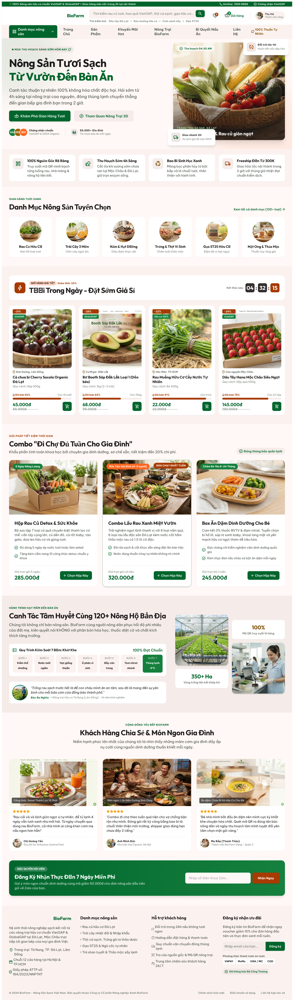
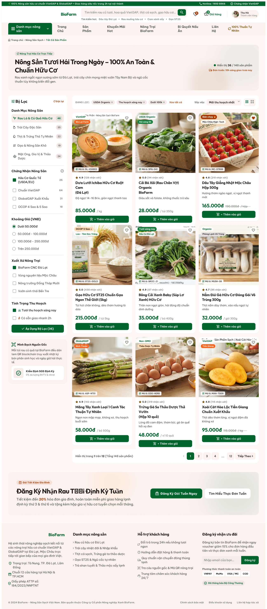

# 🌱 BioFarm – Thiết kế giao diện website nông sản sạch

Bản thiết kế UI (Figma) cho **website thương mại điện tử nông sản sạch**. Khách hàng có thể xem, lọc và đặt mua rau củ, trái cây, thịt trứng, gạo… đạt chuẩn **VietGAP / GlobalGAP / Hữu cơ**, truy xuất nguồn gốc bằng mã QR và được giao nhanh trong 2 giờ.

---

## 📁 Cấu trúc repo

```
Figma/
├── design/
│   └── screens/
│       ├── trang-chu.png    # Trang chủ
│       └── san-pham.png     # Trang danh sách sản phẩm
└── README.md
```

## 🔗 Xem bản thiết kế

- **Figma online:** [Mở trên Figma](https://www.figma.com/design/...) <!-- dán link Share vào đây -->

---

## 📸 Giao diện

### 🏠 Trang chủ


### 🛒 Trang danh sách sản phẩm


---

## 🖥️ Chi tiết các trang

### 1. Trang chủ
| Khu vực | Nội dung |
|---|---|
| **Header** | Logo, thanh tìm kiếm có gợi ý từ khóa hot, yêu thích, giỏ hàng, tài khoản thành viên |
| **Menu** | Danh mục nông sản, Trang chủ, Sản phẩm, Khuyến mãi hot, Nông trại BioFarm, Bí quyết nấu ăn, Liên hệ |
| **Hero banner** | "Nông Sản Tươi Sạch – Từ Vườn Đến Bàn Ăn", nút *Khám phá gian hàng* và *Tham quan nông trại 3D* |
| **Cam kết** | Nguồn gốc rõ ràng (QR), thu hoạch sớm 4h sáng, bao bì sinh học, freeship từ 300K |
| **Danh mục tuyển chọn** | Rau củ, trái cây, nấm & hạt, trứng & thịt, gạo, mật ong & thảo mộc |
| **Flash sale** | "Tươi trong ngày – Đặt sớm giá sỉ", đồng hồ đếm ngược, thanh tiến độ đã bán |
| **Combo gia đình** | Hộp rau củ Detox, Combo lẩu rau xanh, Box ăn dặm cho bé |
| **Về nông trại** | Quy trình kiểm soát 7 bước, số liệu (350+ ha, 120+ nông hộ) |
| **Đánh giá khách hàng** | Thẻ review có ảnh món ăn và xếp hạng sao |
| **Đăng ký Zalo** | Nhận thực đơn 7 ngày miễn phí và voucher |
| **Footer** | Thông tin liên hệ, danh mục, hỗ trợ khách hàng, đăng ký nhận ưu đãi, phương thức thanh toán |

### 2. Trang danh sách sản phẩm
| Khu vực | Nội dung |
|---|---|
| **Breadcrumb và banner** | Trang chủ › Nông sản sạch › Tất cả sản phẩm |
| **Bộ lọc (sidebar)** | Danh mục, chứng nhận (USDA/EU, VietGAP, GlobalGAP, OCOP), khoảng giá, xuất xứ nông trại, tình trạng thu hoạch |
| **Thanh công cụ** | Hiển thị các bộ lọc đang áp dụng, sắp xếp, đổi kiểu xem lưới/danh sách |
| **Thẻ sản phẩm** | Ảnh, nhãn chứng nhận, mã lô, đánh giá sao, mô tả ngắn, giá, nút *Thêm vào giỏ* |
| **Minh bạch nguồn gốc** | Tem QR blockchain, kiểm định SGS |
| **Phân trang** | 12 sản phẩm/trang |
| **Gói định kỳ** | Đăng ký nhận rau tươi theo tuần, tiết kiệm 20% |

---

## 🎨 Style guide

| Thành phần | Giá trị |
|---|---|
| Màu chính | Xanh lá đậm (nút, nhãn, tiêu đề) |
| Màu nhấn | Cam/đỏ cho giảm giá, flash sale, khuyến mãi |
| Nền | Kem/be nhạt, thẻ nền trắng bo góc |
| Khung trang | Rộng 1280px (desktop) |

---

## 👥 Thành viên nhóm

| STT | Họ tên | MSSV | Phụ trách |
|---|---|---|---|
| 1 | Phạm Nguyễn Yến Hà | | |
| 2 | Trần Tân Thuận | | |
| 3 | Phạm Mai Trong Hiếu | | |
| 4 | Bùi Thành Đạt | | |
| 5 | Trần Nguyễn Gia Huy | | |

## 📌 Ghi chú

- Sản phẩm, giá, đánh giá và thông tin liên hệ trong thiết kế chỉ là **dữ liệu mẫu**.
- Mỗi lần cập nhật thiết kế: xuất lại ảnh PNG từ Figma vào `design/screens/`, rồi commit và push.
